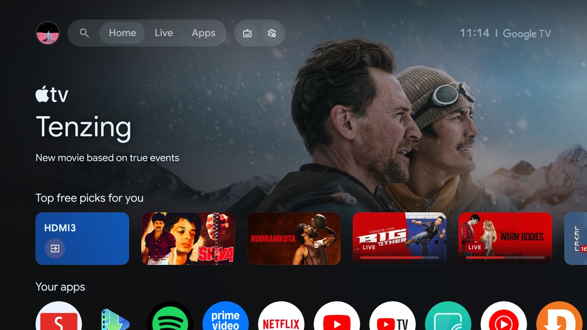
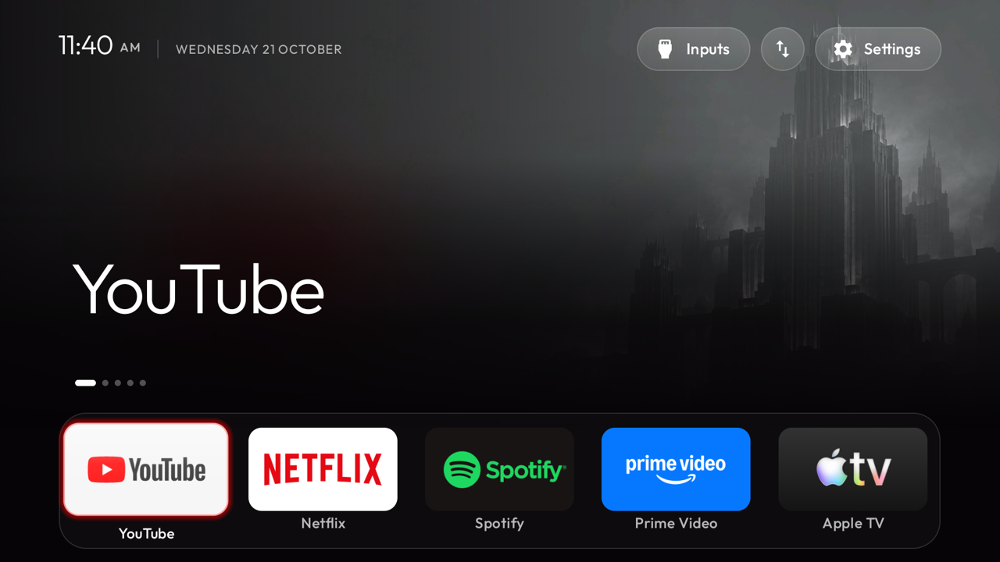
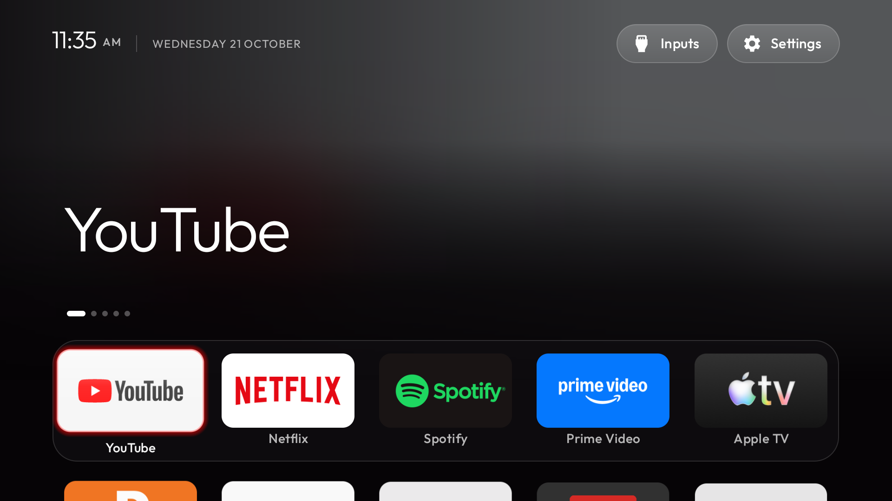

# tv-cleanup

Clean up an Android TV or Google TV: remove apps you do not use (reversibly), shorten animations, set up IPTV in OwnTV, install SmartTube, and apply a launcher theme you choose. It works as a skill for Claude Code and Codex, or with any AI assistant that can read this repo.

## Before and after

| Before: stock Google TV home | After: tv-cleanup launcher |
|---|---|
|  |  |

What changed on the TV:

- The launcher replaces Google TV's home, so the featured title and "Top free picks" rows are not shown. You see the apps you chose.
- The dock holds the apps you pick, in the order you set. A theme sets which apps and how many.
- Google TV's extra apps and TV-maker promotions are disabled, not uninstalled (`lists/`). The Play Store and Downloader are never touched.
- Animations are shorter (`scripts/speed.sh`). Every change has an undo: `scripts/revert.sh`.

## The launcher

The launcher in `launcher/` has a glass look and a few optional widgets. Everything is off until you choose it. You build and install the APK once (`docs/launcher.md`).

- 16 themes with wallpapers, including light versions, and optional theme rotation.
- Glass app tiles and a glass dock with magnification.
- Calendar (weekly or monthly), days-left-in-year and weather cards.
- A widget row with a continue-watching tile.
- Screensaver widgets, and a widget size setting.
- A PlayStation, Xbox or Switch tile when one is on HDMI.

Weather and the continue-watching picture use the internet, so the assistant asks before turning them on. Details, keys and undo steps: `docs/launcher.md`.

## Themes

| Gotham (dark city) | Clean, no wallpaper |
|---|---|
|  |  |

Five presets ship: `dark`, `batman`, `tesla`, `aurora` and `compact` (see `themes/README.md`). The Gotham picture uses a wallpaper, which this repo does not include; the presets are colour-only. The launcher also bundles 16 themes with their own wallpapers (`themes/README.md`).

More screenshots, and how to take your own: `docs/screenshots/README.md`.

## Set up with an AI

Paste this into any AI assistant:

```text
Set up my Android TV with https://github.com/kundan0907/tv-cleanup — start with START_HERE.md and ask before each change.
```

The assistant asks about your TV, network, theme, apps and IPTV, then shows each step before it runs. A cloud chat can plan and guide, but it cannot reach a TV on your home network. For the ADB steps, use Claude Code or the Codex CLI on the same Wi-Fi.

## What you get

| Step | What it does | Undo |
|---|---|---|
| Debloat | Disables Google and TV-maker apps you do not use (`lists/`) | `scripts/revert.sh` |
| Speed | Halves animation scales | `scripts/revert.sh` |
| Launcher and theme | Dark, Batman, Tesla, Aurora or Compact (`themes/`), plus launcher options (`scripts/launcher_options.py`) | `scripts/apply-theme.sh <tv> --reset` |
| IPTV | Public channels from iptv-org, checked and filtered for OwnTV (`iptv/`) | Remove the playlist in OwnTV |
| SmartTube | Installed from its official release (`docs/smarttube.md`) | Uninstall it |
| Free movies | Legal free sources (`docs/free-movies.md`) | Not applicable |

Nothing is uninstalled. The Play Store and Downloader are never touched (`lists/keep.txt`). See `docs/safety.md`.

## Quick start

1. Paste the prompt from "Set up with an AI" into your assistant, or point Claude Code or Codex at this repo.
2. Turn on ADB on the TV (`docs/setup.md`) when the assistant asks.
3. Answer the questions. Each step is shown before it runs.

Optional: install it as a skill (see `SKILL.md`).

Run the scripts by hand if you prefer:

```bash
scripts/connect.sh 192.0.2.10
scripts/debloat.sh 192.0.2.10 light --dry-run
scripts/debloat.sh 192.0.2.10 light
scripts/apply-theme.sh 192.0.2.10 themes/dark
```

## Tests

```bash
python3 -m unittest discover -s tests
```

The tests use a fake `adb`, so they do not need a TV. They check the keep list, the setup-wizard and HOME guards, dry-run behaviour, the undo record, the theme checker and the AI entry points.

## Status

- Tested: the scripts' dry-run and undo paths (fake ADB), the theme checker, the playlist verifier (a local test server), and the AI entry points.
- Not tested here: a real TV run of these scripts. The launcher builds and runs on its author's TV; build it yourself first (`docs/launcher.md`). Test on your own TV first.

## Credits

- **Clean Your TV** by Gathin (MIT): the launcher in `launcher/`, and the safety rules that came from its device notes. See `NOTICE`.
- **iptv-org** (Unlicense): the playlist index used at run time.
- **OwnTV**, **SmartTube**: players you install separately from their own projects.

## License

MIT. See `LICENSE` and `NOTICE`.
